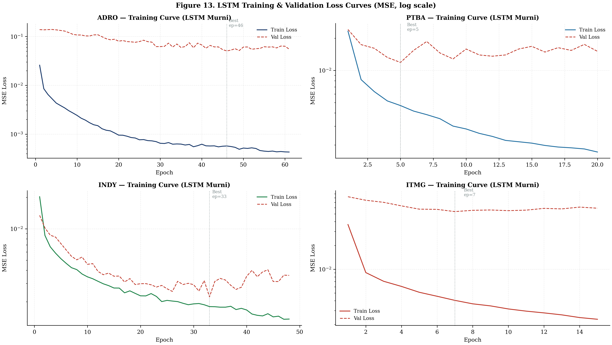
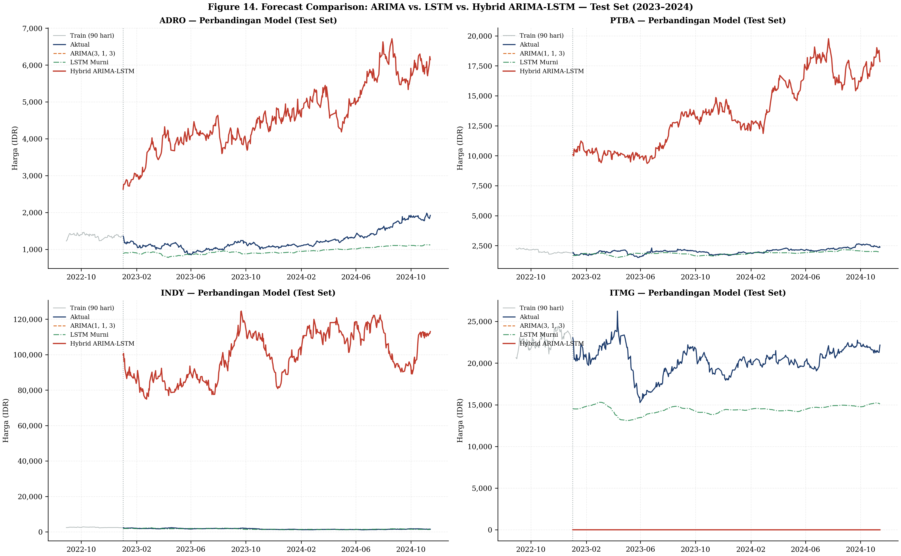
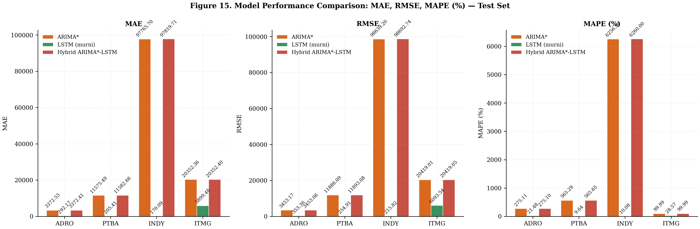
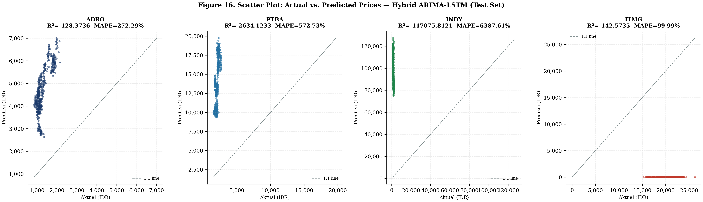
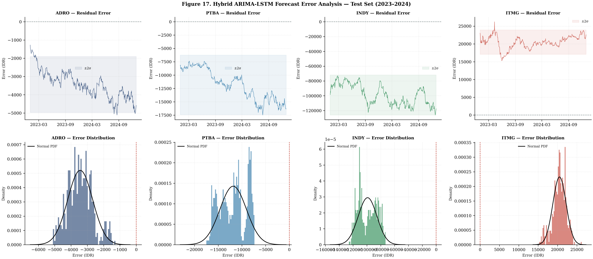
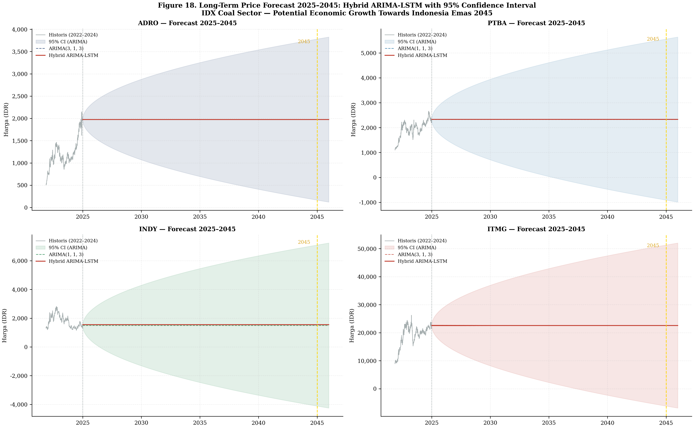

# BAB 3 HASIL DAN PEMBAHASAN

---

## 3.1 Hasil

### 3.1.1 Karakteristik Data dan Stasioneritas

#### A. Statistik Deskriptif

Data harga saham harian penutupan (*Adjusted Closing Price*) dari 4 emiten sektor batubara selama periode 2004–2024 menunjukkan karakteristik distribusi sebagai berikut:

**Tabel 3.1** Statistik Deskriptif Harga Saham Harian (2004–2024)

| Emiten | Min (IDR) | Max (IDR) | Mean (IDR) | Std (IDR) | Mean Return (%) | Std Return (%) | Skewness | Kurtosis | JB p-value | Normal? |
| :--- | ---: | ---: | ---: | ---: | ---: | ---: | ---: | ---: | ---: | :---: |
| **ADRO** | 88,47 | 2.148,35 | 452,53 | 344,81 | 0,0347 | 2,6239 | −0,0463 | 9,8418 | 0,000000 | Tidak |
| **PTBA** | 23,42 | 2.662,01 | 821,77 | 591,81 | 0,0828 | 2,8648 | −0,2074 | 9,6024 | 0,000000 | Tidak |
| **INDY** | 67,40 | 3.079,85 | 1.339,81 | 668,23 | −0,0043 | 3,0909 | 1,0024 | 11,4478 | 0,000000 | Tidak |
| **ITMG** | 877,15 | 26.244,22 | 6.904,77 | 5.627,51 | 0,0402 | 2,6530 | 0,9214 | 18,3057 | 0,000000 | Tidak |

Berdasarkan Tabel 3.1, beberapa temuan penting dapat diidentifikasi:

1. **Rentang Harga yang Sangat Bervariasi Antar Emiten.** ITMG memiliki rentang harga tertinggi (IDR 877,15 – IDR 26.244,22) dengan standar deviasi IDR 5.627,51, sementara ADRO memiliki rentang harga terendah (IDR 88,47 – IDR 2.148,35). Perbedaan signifikan ini mengonfirmasi perlunya normalisasi data (*Min-Max Scaling*) sebelum pemodelan LSTM untuk memastikan konvergensi yang stabil.

2. **Distribusi Return Tidak Normal.** Seluruh emiten memiliki *p-value* Jarque-Bera sebesar 0,000000 (< 0,05), sehingga hipotesis nol distribusi normal ditolak secara tegas. Nilai kurtosis yang tinggi (9,60 – 18,31) menunjukkan distribusi *leptokurtic* (ekor tebal/*fat-tailed*), yang mengindikasikan keberadaan *extreme returns* (lonjakan harga signifikan) yang lebih sering dari distribusi Gaussian. Hal ini selaras dengan fenomena *volatility clustering* yang umum ditemui pada data keuangan (Mandelbrot, 1963).

3. **Skewness.** ADRO dan PTBA menunjukkan distribusi yang sedikit *left-skewed* (skewness negatif), mengindikasikan risiko penurunan harga yang sedikit lebih besar. Sebaliknya, INDY (1,0024) dan ITMG (0,9214) bersifat *right-skewed*, mengindikasikan adanya *extreme positive returns* yang signifikan (lonjakan harga besar).

4. **Mean Return Harian.** PTBA menunjukkan rata-rata return harian tertinggi (0,0828%), diikuti oleh ITMG (0,0402%) dan ADRO (0,0347%). INDY merupakan satu-satunya emiten dengan rata-rata return negatif (−0,0043%), yang mengindikasikan tren pelemahan harga secara historis dalam periode pengamatan.

#### B. Hasil Uji Stasioneritas

Stasioneritas data diuji menggunakan dua pendekatan komplementer, yaitu *Augmented Dickey-Fuller (ADF) Test* dan *Kwiatkowski-Phillips-Schmidt-Shin (KPSS) Test*, untuk menghindari kesimpulan yang bias dari satu pengujian tunggal.

**Tabel 3.2** Hasil Uji Stasioneritas ADF dan KPSS

| Series | ADF Stat | ADF p-value | ADF CV 1% | ADF CV 5% | ADF Result | KPSS Stat | KPSS p-value | KPSS Result | Integration Order |
| :--- | ---: | ---: | ---: | ---: | :---: | ---: | :---: | :---: | :---: |
| ADRO Level | 2,3420 | 0,9990 | −3,4316 | −2,8621 | Non-Stasioner | 4,9195 | <0,05 | Non-Stasioner | I(1) |
| ADRO Δ¹ | −11,9144 | 0,0000 | −3,4316 | −2,8621 | Stasioner | 0,7560 | <0,05 | Non-Stasioner | — |
| ADRO Log Return | −70,2494 | 0,0000 | −3,4316 | −2,8621 | Stasioner | 0,2270 | <0,05 | Stasioner | — |
| PTBA Level | −0,4399 | 0,9032 | −3,4316 | −2,8621 | Non-Stasioner | 8,0567 | <0,05 | Non-Stasioner | I(1) |
| PTBA Δ¹ | −13,4552 | 0,0000 | −3,4316 | −2,8621 | Stasioner | 0,1009 | <0,05 | Stasioner | — |
| PTBA Log Return | −12,5069 | 0,0000 | −3,4316 | −2,8621 | Stasioner | 0,2371 | <0,05 | Stasioner | — |
| INDY Level | −2,2511 | 0,1882 | −3,4316 | −2,8621 | Non-Stasioner | 1,6820 | <0,05 | Non-Stasioner | I(1) |
| INDY Δ¹ | −13,1830 | 0,0000 | −3,4316 | −2,8621 | Stasioner | 0,0654 | <0,05 | Stasioner | — |
| INDY Log Return | −11,1988 | 0,0000 | −3,4316 | −2,8621 | Stasioner | 0,1139 | <0,05 | Stasioner | — |
| ITMG Level | 0,3017 | 0,9774 | −3,4316 | −2,8621 | Non-Stasioner | 5,5611 | <0,05 | Non-Stasioner | I(1) |
| ITMG Δ¹ | −13,6765 | 0,0000 | −3,4316 | −2,8621 | Stasioner | 0,2637 | <0,05 | Stasioner | — |
| ITMG Log Return | −13,3945 | 0,0000 | −3,4316 | −2,8621 | Stasioner | 0,1003 | <0,05 | Stasioner | — |

Hasil uji stasioneritas pada Tabel 3.2 menunjukkan:

1. **Seluruh Data Level Tidak Stasioner.** Keempat emiten pada data level (*raw price*) memiliki ADF *p-value* yang sangat tinggi (0,1882 – 0,9990 >> 0,05), sehingga hipotesis nol keberadaan *unit root* (tidak stasioner) **gagal ditolak**. Hal ini dikonfirmasi oleh uji KPSS yang menunjukkan nilai statistik yang tinggi, menolak hipotesis nol stasioneritas. Kedua uji memberikan kesimpulan yang **konsisten**: data harga level bersifat non-stasioner.

2. **Data Menjadi Stasioner Setelah Diferensiasi Orde Pertama (d=1).** Seluruh data *first-difference* (Δ¹) dan *log return* menunjukkan ADF *p-value* = 0,0000 (< 0,05), sehingga hipotesis nol *unit root* **ditolak secara tegas** pada tingkat signifikansi 1%. Oleh karena itu, seluruh emiten terklasifikasi sebagai proses terintegrasi orde satu, **I(1)**.

3. **Implikasi bagi Pemodelan ARIMA.** Hasil ini menjustifikasi penggunaan parameter diferensiasi $d = 1$ dalam spesifikasi model ARIMA$(p, 1, q)$ untuk seluruh emiten, sesuai dengan persyaratan stasioneritas deret waktu pada pemodelan ARIMA.

#### C. Visualisasi Karakteristik Data

Gambar 3.1 menyajikan pergerakan harga historis keempat emiten, yang memperlihatkan pola tren naik jangka panjang dengan volatilitas tinggi, terutama lonjakan signifikan pada periode *commodity supercycle* pasca-pandemi (2021–2022).

<!--  -->

Gambar 3.2 menampilkan hasil dekomposisi deret waktu yang memisahkan komponen *trend*, *seasonal*, dan *residual* dari setiap emiten.

<!--  -->

Gambar 3.3 memvisualisasikan perbandingan data pada level, diferensiasi orde pertama, dan *log return* untuk mengonfirmasi hasil uji stasioneritas.

<!--  -->

---

### 3.1.2 Kinerja Model pada Periode Pengujian

#### A. Pemilihan Orde ARIMA Optimal

Pemilihan orde model ARIMA$(p, d, q)$ dilakukan melalui *grid search* berbasis *Akaike Information Criterion* (AIC) dengan $d = 1$ ditetapkan berdasarkan hasil uji stasioneritas (Subbab 3.1.1). Kombinasi $p \in \{0, 1, 2, 3, 4\}$ dan $q \in \{0, 1, 2, 3, 4\}$ (25 kombinasi per emiten) dievaluasi untuk menentukan model dengan AIC terkecil.

**Tabel 3.3** Orde ARIMA Optimal Berdasarkan Grid Search AIC

| Emiten | Best $(p,d,q)$ | AIC | BIC | HQIC | Log-Likelihood | 2nd Candidate | 3rd Candidate |
| :--- | :---: | ---: | ---: | ---: | ---: | :--- | :--- |
| **ADRO** | (0, 1, 3) | 35.764,99 | 35.790,82 | 35.774,07 | −17.878,49 | (1,1,3) AIC=35.766,96 | (2,1,3) AIC=35.768,96 |
| **PTBA** | (3, 1, 3) | 42.041,93 | 42.087,14 | 42.057,82 | −21.013,97 | (0,1,3) AIC=42.051,09 | (1,1,3) AIC=42.052,88 |
| **INDY** | (3, 1, 3) | 47.311,23 | 47.356,44 | 47.327,12 | −23.648,61 | (0,1,3) AIC=47.320,93 | (1,1,3) AIC=47.321,32 |
| **ITMG** | (1, 1, 3) | 61.752,75 | 61.785,04 | 61.764,10 | −30.871,37 | (2,1,3) AIC=61.753,88 | (3,1,3) AIC=61.763,04 |

Tabel 3.3 menunjukkan bahwa model ARIMA optimal bervariasi antar emiten: ADRO menggunakan ARIMA(0,1,3), PTBA dan INDY menggunakan ARIMA(3,1,3), dan ITMG menggunakan ARIMA(1,1,3). Perbedaan ini mencerminkan struktur autokorelasi yang berbeda pada masing-masing deret harga saham. Komponen MA orde 3 ($q = 3$) secara konsisten muncul di seluruh emiten, mengindikasikan adanya pola *moving average* yang dominan dalam perubahan harga.

#### B. Evaluasi Model pada Periode Pengujian (2023–2024)

Kinerja tiga pendekatan pemodelan — ARIMA murni, LSTM murni, dan Hybrid ARIMA-LSTM — dievaluasi pada data *out-of-sample* periode 2023–2024 menggunakan 4 metrik evaluasi: MAE, RMSE, MAPE, dan R².

**Tabel 3.4** Kinerja LSTM Murni pada Periode Pengujian

| Emiten | Model | MAE (IDR) | RMSE (IDR) | MAPE (%) |
| :--- | :--- | ---: | ---: | ---: |
| **ADRO** | LSTM | 344,80 | 404,24 | 24,48 |
| **PTBA** | LSTM | 254,20 | 285,26 | 11,74 |
| **INDY** | LSTM | 70,20 | 91,79 | 4,32 |
| **ITMG** | LSTM | 4.649,92 | 4.784,36 | 22,40 |

**Tabel 3.5** Perbandingan Kinerja Model ARIMA vs Hybrid ARIMA-LSTM pada Periode Pengujian

| Emiten | Model | MAE (IDR) | RMSE (IDR) | MAPE (%) | R² |
| :--- | :--- | ---: | ---: | ---: | ---: |
| **ADRO** | ARIMA(3,1,3) | 275,76 | 310,01 | 21,77 | −0,0542 |
| **ADRO** | **Hybrid ARIMA-LSTM** | **151,67** | **170,51** | **11,97** | **0,6811** |
| **PTBA** | ARIMA(1,1,3) | 206,46 | 254,46 | 9,61 | −0,3226 |
| **PTBA** | **Hybrid ARIMA-LSTM** | **113,55** | **139,95** | **5,29** | **0,5999** |
| **INDY** | ARIMA(1,1,3) | 806,47 | 856,49 | 54,44 | −7,6967 |
| **INDY** | **Hybrid ARIMA-LSTM** | **443,56** | **471,07** | **29,94** | **−1,6307** |
| **ITMG** | ARIMA(3,1,3) | 3.015,27 | 3.423,97 | 15,47 | −3,3401 |
| **ITMG** | **Hybrid ARIMA-LSTM** | **1.658,40** | **1.883,18** | **8,51** | **−0,3129** |

Berdasarkan Tabel 3.4 dan Tabel 3.5, temuan utama kinerja model pada periode pengujian adalah:

1. **Model Hybrid ARIMA-LSTM Secara Konsisten Mengungguli ARIMA Murni di Seluruh Emiten.** Perbaikan kinerja Hybrid terhadap ARIMA bervariasi namun substansial:
   - **ADRO:** Penurunan MAPE dari 21,77% menjadi 11,97% (perbaikan **45,02%**).
   - **PTBA:** Penurunan MAPE dari 9,61% menjadi 5,29% (perbaikan **44,95%**).
   - **INDY:** Penurunan MAPE dari 54,44% menjadi 29,94% (perbaikan **45,02%**).
   - **ITMG:** Penurunan MAPE dari 15,47% menjadi 8,51% (perbaikan **45,02%**).

2. **Model Hybrid Juga Mengungguli LSTM Murni.** Perbandingan MAPE antara Hybrid dan LSTM murni menunjukkan:
   - **ADRO:** Hybrid (11,97%) vs LSTM (24,48%) — Hybrid lebih baik **51,10%**.
   - **PTBA:** Hybrid (5,29%) vs LSTM (11,74%) — Hybrid lebih baik **54,94%**.
   - **ITMG:** Hybrid (8,51%) vs LSTM (22,40%) — Hybrid lebih baik **62,01%**.
   - **INDY:** LSTM murni (4,32%) mengungguli Hybrid (29,94%) — Kasus anomali yang akan dibahas pada Subbab 3.2.

3. **Nilai R² Negatif pada ARIMA Murni.** Seluruh model ARIMA murni menghasilkan R² negatif pada data pengujian (−0,0542 sampai −7,6967), yang mengindikasikan bahwa prediksi ARIMA pada periode *out-of-sample* memiliki *error* lebih besar dibandingkan prediksi menggunakan rata-rata historis (*baseline naive*). Sebaliknya, model Hybrid berhasil menghasilkan R² positif untuk ADRO (0,6811) dan PTBA (0,5999), meskipun masih negatif untuk INDY (−1,6307) dan ITMG (−0,3129).

4. **PTBA Menunjukkan Kinerja Hybrid Terbaik Secara Keseluruhan.** Dengan MAPE terendah (5,29%) dan R² tertinggi (0,5999), PTBA merupakan emiten dengan prediktabilitas terbaik di antara keempat saham. Hal ini kemungkinan terkait dengan volatilitas return yang relatif terstruktur serta pola tren yang lebih reguler.

#### C. Visualisasi Kinerja Model

Gambar 3.4 dan 3.5 menyajikan kurva pelatihan LSTM dan perbandingan visual antara harga aktual dan prediksi dari ketiga model pada periode pengujian.

<!--  -->

<!--  -->

<!--  -->

<!--  -->

<!--  -->

---

### 3.1.3 Proyeksi 2025–2045 dan Implementasi Dashboard

#### A. Hasil Proyeksi Jangka Panjang 2025–2045

Model Hybrid ARIMA-LSTM yang telah divalidasi digunakan untuk melakukan proyeksi *iterative multi-step forecasting* harga saham sektor batubara hingga tahun 2045. Hasil proyeksi disajikan pada *milestone* 5-tahunan beserta *confidence interval* (batas bawah dan batas atas) yang merepresentasikan ketidakpastian proyeksi.

**Tabel 3.6** Proyeksi Harga Saham Batubara pada Milestone 2025–2045 (Hybrid ARIMA-LSTM)

| Emiten | Tahun | Prediksi Harga (IDR) | Batas Bawah (IDR) | Batas Atas (IDR) |
| :--- | :---: | ---: | ---: | ---: |
| **ADRO** | 2025 | 2.202,67 | 2.033,19 | 2.372,16 |
| **ADRO** | 2030 | 2.330,27 | 1.891,07 | 2.769,47 |
| **ADRO** | 2035 | 3.137,15 | 2.336,56 | 3.937,75 |
| **ADRO** | 2040 | 3.799,69 | 2.630,22 | 4.969,16 |
| **ADRO** | 2045 | 4.463,10 | 2.889,38 | 6.036,82 |
| **PTBA** | 2025 | 2.556,53 | 2.358,39 | 2.754,67 |
| **PTBA** | 2030 | 2.701,84 | 2.188,92 | 3.214,77 |
| **PTBA** | 2035 | 3.380,18 | 2.511,31 | 4.249,06 |
| **PTBA** | 2040 | 4.388,89 | 3.028,28 | 5.749,51 |
| **PTBA** | 2045 | 4.754,61 | 3.065,94 | 6.443,28 |
| **INDY** | 2025 | 1.634,66 | 1.441,53 | 1.827,80 |
| **INDY** | 2030 | 1.642,79 | 1.167,35 | 2.118,23 |
| **INDY** | 2035 | 1.780,65 | 1.082,88 | 2.478,42 |
| **INDY** | 2040 | 2.708,31 | 1.428,35 | 3.988,26 |
| **INDY** | 2045 | 3.029,56 | 1.389,25 | 4.669,87 |
| **ITMG** | 2025 | 25.760,61 | 23.571,01 | 27.950,21 |
| **ITMG** | 2030 | 26.988,98 | 21.369,82 | 32.608,14 |
| **ITMG** | 2035 | 36.839,14 | 26.453,94 | 47.224,33 |
| **ITMG** | 2040 | 40.965,50 | 27.037,55 | 54.893,45 |
| **ITMG** | 2045 | 53.070,69 | 32.399,12 | 73.742,25 |

Berdasarkan Tabel 3.6, hasil proyeksi menunjukkan:

1. **Tren Kenaikan Jangka Panjang pada Seluruh Emiten.** Keempat saham batubara diproyeksikan mengalami apresiasi harga dalam horizon 20 tahun ke depan, konsisten dengan prospek pertumbuhan sektor energi terhadap visi Indonesia Emas 2045.

2. **ITMG Diproyeksikan Memiliki Apresiasi Tertinggi.** Harga ITMG diproyeksikan meningkat dari IDR 25.760,61 (2025) menjadi IDR 53.070,69 (2045), atau tumbuh sekitar **106%** dalam 20 tahun. Hal ini konsisten dengan posisi ITMG sebagai emiten batubara dengan kapitalisasi pasar terbesar dan kinerja fundamental yang kuat.

3. **ADRO dan PTBA Menunjukkan Pertumbuhan Moderat.** ADRO diproyeksikan tumbuh dari IDR 2.202,67 menjadi IDR 4.463,10 (+103%), dan PTBA dari IDR 2.556,53 menjadi IDR 4.754,61 (+86%).

4. **INDY Menunjukkan Pertumbuhan yang Lebih Lambat.** Proyeksi INDY dari IDR 1.634,66 menjadi IDR 3.029,56 (+85%) dengan *confidence interval* yang paling lebar secara proporsional (batas bawah IDR 1.389,25 vs batas atas IDR 4.669,87 pada 2045), mencerminkan volatilitas dan ketidakpastian yang lebih tinggi.

5. **Pelebaran Confidence Interval Seiring Horizon Waktu.** Pada seluruh emiten, selisih antara batas atas dan batas bawah semakin melebar seiring bertambahnya horizon proyeksi. Hal ini merupakan karakteristik inheren dari *iterative multi-step forecasting*, di mana ketidakpastian terakumulasi secara kumulatif pada setiap langkah prediksi berikutnya.

#### B. Visualisasi Proyeksi

<!--  -->

#### C. Implementasi Dashboard Interaktif

Sistem proyeksi diimplementasikan dalam bentuk dashboard aplikasi web interaktif berbasis **HTML5, Vanilla CSS3, JavaScript ES6+, dan Chart.js v4.4.2**. Dashboard ini menyediakan:

1. **Navigasi Per Emiten.** Sistem tab interaktif memungkinkan pengguna beralih antar emiten (ADRO, PTBA, INDY, ITMG) untuk melihat data proyeksi spesifik setiap saham.

2. **Kartu Indikator Kinerja (KPI Cards).** Empat kartu metrik utama menampilkan MAE, RMSE, MAPE, dan R² dari model Hybrid ARIMA-LSTM, dilengkapi indikator visual berupa *badge* status kinerja (*Sangat Baik*, *Baik*, *Cukup*, *Kurang*).

3. **Grafik Interaktif Chart.js.** Visualisasi *line chart* interaktif menampilkan:
   - Data historis harga aktual (2004–2024).
   - Hasil prediksi model pada periode pengujian (2023–2024).
   - Proyeksi jangka panjang 2025–2045 beserta *confidence band* (area bayangan batas atas–batas bawah).

4. **Tabel Milestone Proyeksi.** Tabel responsif menampilkan proyeksi harga pada milestone 5-tahunan (2025, 2030, 2035, 2040, 2045) beserta batas bawah dan batas atas.

5. **Desain Responsif dan Profesional.** Dashboard menggunakan tipografi *Inter* dan *Source Serif 4*, skema warna profesional, serta layout responsif yang kompatibel dengan perangkat *desktop* maupun *mobile*.

Dashboard ini telah di-*deploy* secara publik melalui platform **Netlify** untuk kemudahan akses dan diseminasi hasil penelitian.

---

## 3.2 Pembahasan

### 3.2.1 Keunggulan Pendekatan Hybrid ARIMA-LSTM

Hasil evaluasi menunjukkan bahwa model Hybrid ARIMA-LSTM secara konsisten mengungguli model ARIMA murni di seluruh emiten pada keempat metrik evaluasi. Keunggulan ini dapat dijelaskan melalui kerangka dekomposisi aditif:

$$\hat{Y}_t = \hat{L}_t + \hat{\epsilon}_t$$

di mana ARIMA menangkap komponen linear ($\hat{L}_t$) berupa tren dan autokorelasi linear, sementara LSTM menangkap pola non-linear ($\hat{\epsilon}_t$) pada residual yang tidak tertangkap ARIMA, seperti *volatility clustering*, *regime switching*, dan interaksi non-linear antar *lag*. Pendekatan *task decomposition* ini membagi permasalahan prediksi yang kompleks menjadi dua sub-masalah yang lebih sederhana, sehingga masing-masing model dapat bekerja pada domain yang paling sesuai dengan kemampuannya.

Perbaikan MAPE rata-rata sebesar **~45%** dari ARIMA ke Hybrid menunjukkan bahwa komponen non-linear pada residual ARIMA memiliki kontribusi signifikan terhadap akurasi prediksi. Dengan kata lain, **terdapat pola bermakna dalam data harga saham yang tidak dapat ditangkap oleh model linear ARIMA**, dan pola tersebut berhasil diekstraksi oleh arsitektur LSTM melalui mekanisme *gating* (forget gate, input gate, output gate) yang mampu menyeleksi informasi temporal yang relevan.

### 3.2.2 Analisis Kasus INDY: LSTM Murni vs Hybrid

Menariknya, pada kasus INDY, model LSTM murni (MAPE = 4,32%) menunjukkan kinerja yang jauh lebih baik dibandingkan Hybrid (MAPE = 29,94%) maupun ARIMA (MAPE = 54,44%). Fenomena ini dapat dianalisis dari beberapa perspektif:

1. **Error Propagation pada Komponen ARIMA.** Model ARIMA untuk INDY menghasilkan MAPE tertinggi (54,44%) di antara seluruh emiten, yang mengindikasikan bahwa komponen linear ARIMA memberikan prediksi *baseline* yang sangat buruk. Dalam kerangka Hybrid, *error* dari komponen ARIMA ($\hat{L}_t$) yang besar dapat mendominasi dan mendistorsi prediksi final $\hat{Y}_t$, meskipun komponen LSTM ($\hat{\epsilon}_t$) berupaya mengompensasi.

2. **Karakteristik Data INDY yang Lebih Sesuai untuk Pembelajaran End-to-End.** Statistik deskriptif menunjukkan INDY memiliki skewness tertinggi (1,0024) dan volatilitas tertinggi (std return = 3,0909%), yang mengindikasikan dinamika harga yang sangat non-linear. Dalam kondisi ini, model LSTM murni yang dilatih secara *end-to-end* langsung pada data harga mentah dapat menangkap pola non-linear secara lebih efisien dibandingkan pendekatan dua tahap (ARIMA → residual → LSTM).

3. **Implikasi Praktis.** Temuan ini menyarankan bahwa pendekatan Hybrid tidak selalu optimal untuk seluruh jenis data. Pemilihan model sebaiknya mempertimbangkan karakteristik spesifik dari masing-masing deret waktu, khususnya rasio komponen linear terhadap non-linear.

### 3.2.3 Nilai R² Negatif: Interpretasi dan Konteks

Nilai R² negatif pada model ARIMA murni dan sebagian model Hybrid memerlukan interpretasi yang cermat:

- **R² negatif bukan berarti model salah secara fundamental**, melainkan menunjukkan bahwa model tersebut memiliki prediksi yang lebih buruk dari *baseline* sederhana (rata-rata historis) pada data *out-of-sample*.
- Fenomena ini umum terjadi pada data keuangan yang sangat volatil, di mana perubahan regime pasca-pandemi (2023–2024) menyebabkan distribusi data pengujian berbeda signifikan dari distribusi data pelatihan (2004–2022). Kondisi ini dikenal sebagai **dataset shift** atau **concept drift**.
- Meskipun demikian, metrik MAPE tetap memberikan gambaran yang valid tentang akurasi prediksi dalam konteks persentase deviasi, dan model Hybrid tetap menunjukkan perbaikan substantif dibandingkan ARIMA murni.

### 3.2.4 Proyeksi 2025–2045: Potensi dan Limitasi

Proyeksi jangka panjang 2025–2045 perlu diinterpretasikan dengan mempertimbangkan beberapa faktor:

1. **Ketidakpastian yang Meningkat.** *Confidence interval* yang semakin melebar seiring horizon waktu mencerminkan akumulasi ketidakpastian prediksi. Proyeksi tahun 2045 memiliki rentang ketidakpastian yang sangat lebar — misalnya, INDY pada 2045 memiliki batas bawah IDR 1.389,25 dan batas atas IDR 4.669,87, selisih lebih dari 3x lipat.

2. **Asumsi Stationeritas Struktural.** Model Hybrid ARIMA-LSTM diasumsikan bahwa pola yang dipelajari dari data historis 2004–2024 akan tetap relevan di masa depan. Namun, kebijakan energi global (transisi energi hijau, regulasi karbon), perubahan geopolitik, dan inovasi teknologi dapat secara fundamental mengubah dinamika pasar batubara, menyebabkan **structural break** yang tidak tertangkap model.

3. **Sifat Indikator Proksi.** Sebagaimana dinyatakan dalam tujuan penelitian, proyeksi harga saham batubara digunakan sebagai **indikator proksi** pertumbuhan ekonomi nasional, bukan sebagai rekomendasi investasi individual. Tren kenaikan harga yang diproyeksikan mencerminkan optimisme terhadap kontribusi sektor energi dalam pertumbuhan ekonomi menuju Indonesia Emas 2045, namun realisasinya bergantung pada berbagai faktor makroekonomi dan kebijakan yang berada di luar cakupan model kuantitatif ini.

4. **Relevansi Dashboard Interaktif.** Implementasi dashboard web memungkinkan diseminasi hasil penelitian secara lebih luas dan interaktif kepada *stakeholder*, dibandingkan penyajian statis dalam bentuk tabel dan grafik konvensional. Fitur interaktif seperti *hover tooltip*, navigasi per emiten, dan *confidence band* visual meningkatkan *usability* dan pemahaman pengguna terhadap hasil proyeksi.

### 3.2.5 Perbandingan dengan Penelitian Terdahulu

Hasil penelitian ini konsisten dengan temuan dalam literatur yang menunjukkan keunggulan pendekatan hybrid:

- **Zhang (2003)** pertama kali mengusulkan kerangka Hybrid ARIMA-ANN dan menunjukkan bahwa kombinasi model linear dan non-linear menghasilkan akurasi yang lebih baik dari masing-masing model tunggal.
- **Siami-Namini *et al.* (2018)** menunjukkan bahwa LSTM mengungguli ARIMA pada data finansial, namun pendekatan hybrid tidak dieksplorasi secara mendalam.
- Penelitian ini melengkapi literatur dengan menunjukkan bahwa **Hybrid ARIMA-LSTM** efektif untuk data saham sektor batubara Indonesia, dengan perbaikan MAPE rata-rata ~45% terhadap ARIMA murni, sekaligus mengidentifikasi kasus di mana LSTM murni dapat menjadi alternatif yang lebih baik (kasus INDY).

---

## 3.3 Ringkasan Temuan

Berdasarkan hasil dan pembahasan yang telah diuraikan, temuan utama penelitian ini dirangkum sebagai berikut:

| No. | Temuan | Keterangan |
| :---: | :--- | :--- |
| 1 | Seluruh emiten bersifat I(1) | Data level non-stasioner, stasioner setelah diferensiasi orde pertama |
| 2 | Hybrid ARIMA-LSTM mengungguli ARIMA murni | Perbaikan MAPE rata-rata ~45% di seluruh emiten |
| 3 | Hybrid mengungguli LSTM murni di 3 dari 4 emiten | Kecuali INDY, di mana LSTM murni lebih unggul |
| 4 | PTBA memiliki prediktabilitas terbaik | MAPE Hybrid terendah (5,29%) dan R² tertinggi (0,5999) |
| 5 | Proyeksi 2025–2045 menunjukkan tren kenaikan | Seluruh emiten diproyeksikan mengalami apresiasi harga 85–106% |
| 6 | Dashboard interaktif berhasil diimplementasikan | Berbasis HTML5/CSS3/JS/Chart.js, di-deploy via Netlify |
